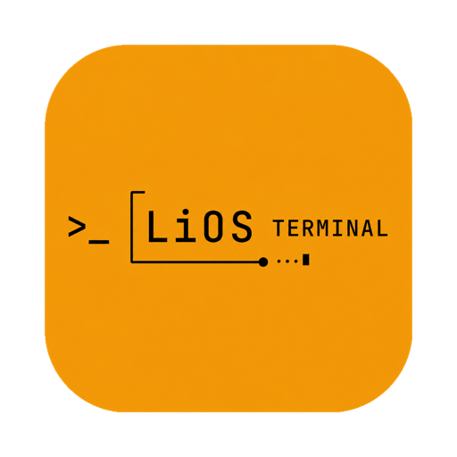

<p align="center">

> **2026-10-13 AI-access lock:** BYOAI means **Bring Your Own AI Access / Entitlement**, not merely API keys. OpenClaw is the primary donor for account/auth-profile, OAuth, native/CLI runtime, fallback, local-model and related user-owned AI access patterns. Normal customer inference remains user-owned; LiOS must not become a general hosted inference proxy. See `docs/technical/OPENCLAW_AI_ACCESS_ASSIMILATION_DIRECTIVE.md`.

> **2026-10-02 architecture lock:** LiOS is **deployable user-owned software, not a hosted intelligence service**. Desktop Local / **LiOS Home** is the default; users may expand into their own database, storage, NAS/server/VPS/cloud, compute, models, secrets and network. LiOS operates no customer runtime/data cloud. OpenClaw `v2026.9.7` is now a major MIT donor for Gateway/device, execution, native mobile/watch, agent, coding, browser, memory and self-hosted infrastructure. See `docs/technical/OPENCLAW_ASSIMILATION_BLUEPRINT.md`.


> **2026-09-26 entry lock:** LiOS now uses a **public, non-executable product preview → mandatory authentication/entitlement boundary → authenticated AI-first workspace**. The public screen may show representative terminal UI, capabilities, workflows and plans, but it must not execute AI, research, data, engines, connectors, Projects, Chats or Artifacts. Returning authenticated users restore directly into the workspace. Guest execution is retired.
  
</p>

<h1 align="center">LiOS Intelligence Terminal</h1>

<p align="center">
  A conversation-first Super Intelligence operating system for any-topic research and professional work, with specialist deterministic finance, Projects, chats, live Artifacts, provider-neutral BYOD/BYOAI, persistent state, automation and user-owned Home.
</p>

> **Public source distribution:** `kiranvbiim-coder/lios-terminal` — sanitized source snapshot; original development repository and history remain private.
> **Default branch:** `main`  
> **Implementation authority:** `AGENTS.md`, the final SI execution plan, mandatory Shipping Point contract and canonical subsystem/product docs below.

This distribution contains source code and synthetic test fixtures, **not private work, provider datasets, database/vault backups, model weights, native installers or the original Git history**. LiOS remains proprietary original code under [LICENSE](LICENSE); third-party licenses remain intact.

Shiller CAPE and compatibility-catalog observations require separately supplied, permitted local data. Absence is reported explicitly; this repository does not silently fetch, invent or redistribute those observations. Real-scale data benchmarks and packaged/signing/Shipping Point evidence remain separate from source CI.

For CAPE, explicitly set `LIOS_SHILLER_CAPE_FILE` to a local JSON file you are permitted to use; rows must carry the existing `year`, `month`, `cape`, `realPrice` and `realEarnings` fields. No dataset is downloaded automatically. Compatibility catalogs may be provided locally through the existing user-owned data paths; those payloads remain ignored by Git.

Only unprivileged standard-hosted source validation is enabled here. There are no self-hosted runners, signing secrets or release publishing workflows. Review each CI result rather than inferring platform acceptance from this source snapshot.

## Public-source rights and CI

Original LiOS material is **proprietary, publicly viewable source**, not generally MIT/Apache-licensed open source. See [LICENSE](LICENSE). Third-party components retain their own licenses and notices in [THIRD_PARTY_NOTICES.md](THIRD_PARTY_NOTICES.md); public visibility does not grant provider/data/model rights.

Standard GitHub-hosted Linux, macOS and Windows source-validation jobs are defined in `.github/workflows/source-cross-platform.yml`. They do not require production credentials and do not publish releases. Public-repository standard-runner compute is free under GitHub's applicable terms, not unlimited: concurrency, runtime, storage and fair-use limits still apply. Source CI does not establish native packaged Shipping Point or signed-release acceptance.

Before changing visibility, review **all public branches and Git history**, issues/PR discussions, existing logs/artifacts/releases, data/asset rights and runner access. Rotate any exposed real credentials; deleting a current file does not remove historical exposure. Never run untrusted pull-request code on persistent/self-hosted machines. See [SECURITY.md](SECURITY.md).

## Source of truth

Before substantial implementation work, read in this order:

1. `AGENTS.md`
2. `docs/LIOS_SUPER_INTELLIGENCE_EXECUTION_PLAN.md`
3. `docs/technical/SUPER_INTELLIGENCE_SHIPPING_POINT_CONTRACT.md`
4. `docs/LIOS_MASTER_PLAN.md`
5. `docs/LIOS_ARCHITECTURE.md`
6. `docs/technical/OPENCLAW_ASSIMILATION_BLUEPRINT.md`
7. `docs/technical/OPENCLAW_AI_ACCESS_ASSIMILATION_DIRECTIVE.md` when AI access, models, auth profiles, OAuth, native/CLI runtimes, fallbacks or local AI are involved
8. `docs/technical/CAPABILITY_ASSIMILATION_WORKSTREAM.md`
9. `docs/LIOS_UX_SYSTEM.md`
10. `docs/LIOS_CONNECTOR_SPEC.md`
11. `docs/LIOS_EXECUTION_ROADMAP.md`, implementation, donor truth registry and issue #192 plus active task/PR

Do not reconstruct scope from old V3/V4 branches, deleted plans, old PRs or chat memory. Durable product decisions belong in the canonical docs; temporary execution coordination belongs in GitHub issues/PRs.

## Product direction

The target user model is:

> **Projects → Chats → Artifacts**

The execution model is:

> **Ask → Understand → Execute → Inspect → Refine → Save → Monitor**

Internally:

```text
Project / Chat
    ↓
Conversation Runtime
    ├─ Intent
    ├─ Context
    ├─ State
    ├─ Workflow planning
    └─ Policy / permissions
    ↓
Universal Data Router + Research + Deterministic Engines + BYOAI
    ↓
Verification
    ↓
Live Artifacts
    ↓
Conversation Ledger / Project Graph
    ↓
Automation / Monitoring
```

**Complexity belongs inside LiOS, not in front of the user.**

## Finance-first scope

General conversation, factual search and professional documents/tables/charts may cover any topic. Specialist analytical engine development remains finance-first; preserve broader working capability and native/mobile/watch scope without creating separate product authorities.

The locked finance capability families are:

1. Market Data
2. Company Fundamentals
3. Valuation
4. Portfolio & Risk
5. Fixed Income
6. Derivatives
7. Macro & FX
8. Alternative Assets
9. Corporate Actions & Events
10. Research & Reporting
11. Personal Finance & Wealth

These are capability families, not mandatory navigation modules. The finance map may expand with additional high-value finance-sector capabilities, but capability growth should stay behind the simple Projects/Chats/Artifacts experience. AI is cross-cutting, not a standalone finance module.

## Universal connectivity principle

LiOS is not limited to a fixed provider list. The goal is **connect what the user brings**: legitimate AI subscriptions/entitlements where officially supported, account/OAuth connections, provider-native or CLI runtimes, API keys, local/self-hosted models, private/public APIs, REST/OpenAPI/GraphQL, databases/SQL, files, cloud storage, MCP and other supported protocols should converge into governed LiOS runtime/connector layers whenever technically and legally possible.

## Data and AI principles

- BYOD and BYOAI are core.
- **BYOAI means Bring Your Own AI Access / Entitlement, not merely Bring Your Own API Key.** Supported access may include officially permitted subscriptions/accounts, OAuth, native/CLI runtimes, free/trial access, API keys, enterprise gateways and local/self-hosted models.
- Limuria does not operate a normal customer AI-inference proxy or silently subsidize/convert user inference into LiOS token usage; the user's selected provider/runtime/account owns the underlying inference path and economics unless a future product explicitly changes this contract.
- Private/client data stays local wherever practical.
- Engines request canonical data, never provider brands.
- Raw tickers are not durable identity; use canonical entity/security/listing IDs.
- Home owns one build/web bundle and `/api/auth/*` identity authority; local trial/imported vendor-signed licence does not change ownership. User-owned remote Home is allowed; no LiOS customer runtime/control-plane contact is required.
- OpenFIGI enriches identity; it is not a price/fundamental source. LiOS ships the connector capability, while users bring their own API key/credential.
- Missing data stays missing; never fabricate production observations.
- Provider-neutral does not mean lowest-common-denominator: deeper user entitlements should unlock deeper LiOS capability.
- AI may orchestrate/explain/challenge. Deterministic engines remain authoritative by default; with explicit user permission the connected AI may also produce clearly labelled AI-derived calculations/estimates.
- AI OFF must leave deterministic analytics functional.
- BYOAI inference cost is not silently converted into LiOS token usage.

## UX principles

LiOS combines:

- ChatGPT-style Projects/chats;
- Claude-style side-by-side live artifacts;
- Perplexity-style evidence visibility;
- professional terminal charts/models;
- keyboard-first controls;
- the LiOS matte-dark token system, composed with the approved login-screen treatment as the visual reference for depth, contrast and restrained brand accents.

Current Pulse / Explore / Workbench / Signals / Library capabilities remain useful supporting surfaces while the Projects/Chats/Artifacts model becomes the primary mental model.

Exact visual rules are in `docs/LIOS_UX_SYSTEM.md` and `src/client/src/terminal-theme-lock.css`.


Global/New Chat is minimal; Project Home is a rich adaptive intelligence dashboard with verified metrics, What Changed, live work and stable pins. Working Context is hidden, with no mandatory entity selector/inspector. Important Project outputs must auto-persist as immutable-versioned Artifacts; this required behavior is pending TC-13/P4 integration, while current source requires explicit Keep. Quick/Temporary Keep requires an explicit Project destination.

## Open-source assimilation

LiOS aggressively reuses permissively licensed open source instead of rebuilding commodity infrastructure.

Use:

> **DISCOVER → IMPORT → VERIFY → ADAPT → INTEGRATE → HARDEN**

and:

> **ASSIMILATE → WRAP → EXTEND → BUILD**

Entire useful MIT/BSD/Apache-2.0 subsystems may be copied, vendored, forked and adapted when the exact code/version permits commercial use and the implementation passes LiOS verification.

**OpenClaw is the primary structural/platform donor.** Before building new runtime/platform machinery, inspect the exact pinned OpenClaw implementation first and reuse/adapt complete useful subsystems when they fit LiOS contracts. Build from scratch only after donor analysis shows that reuse/adaptation is unsuitable. LiOS remains the product/state authority and donor branding must not leak into normal product surfaces.

Primary donor/engine directions are defined in docs/LIOS_ARCHITECTURE.md. Important examples include:

- Hitheshkaranth/OpenTerminalUI and ErTasselli/OpenTerminal for terminal/workspace/provider/plugin patterns and reusable code;
- London Strategic Edge (`lse-terminal`, `lse-data`, `brue`) as a high-priority V1 donor/provider family for P5/P6; see `docs/technical/LSE_TECHNOLOGY_ASSIMILATION.md`;
- assistant-ui + tool-ui for conversation and interactive AI tool UI;
- Univer OSS for SpreadsheetArtifact/modeling;
- Perspective/TanStack/DuckDB/Arrow for large DataArtifact workflows;
- ECharts for advanced analytical visualization;
- Tiptap OSS for live reports/research;
- skfolio/CVXPY/QuantLib for portfolio/optimization/fixed-income compute;
- EdgarTools/Arelle/Docling for filing/XBRL/document intelligence;
- LEAN as an optional advanced Quant Runtime Pack;
- OpenTelemetry/OpenLineage-style standards for internal execution observability/lineage.

Open-source verification classifies an imported subsystem as **Production / Adapt / Stub / Reject**. This avoids both unnecessary rebuilding and blind import of demo/fake/insecure behavior.

Software license, external data/API rights, assets and trademarks are separate reviews. A MIT terminal repo does not automatically grant commercial rights to every market-data endpoint it calls.

### P11 Hidden Engine Fabric

Phase 11 turns the preliminary Runtime Pack model into LiOS's hidden first-party Engine Fabric. LiOS capabilities route to isolated/signed packs; upstream engines remain replaceable implementation details. Python engines use isolated pack environments, heavy cross-language engines use supervised local sidecars, large data uses Arrow/Parquet handles, and all packs retain LiOS-owned identity/data/permission/artifact contracts.

See:

- `docs/technical/P11_ENGINE_FABRIC_SPEC.md`
- `docs/technical/P11_OSS_CANDIDATE_MATRIX.md`
- `docs/technical/P11_PACK_MANIFEST_V1.md`
- `third_party/p11-candidates.json`

Every candidate receives a concrete **LIBRARY / VENDOR / SIDECAR / CONNECTOR / REFERENCE / REJECT** decision. Normal product UX remains donor-neutral.

Current foundations/directions include:

| Layer | Current direction |
| --- | --- |
| Desktop | Electron + electron-builder/updater |
| Frontend | React 18, Vite, TypeScript, Tailwind/Radix |
| Conversation UI | assistant-ui candidate integrated against LiOS-owned runtime/state |
| Tool UI | assistant-ui/tool-ui copy/adapt path |
| Backend | Express 5 + Python/FastAPI deterministic sidecar |
| Local/relational data | PGlite/PostgreSQL + Drizzle |
| Local analytics | DuckDB |
| Large/streaming data | Perspective/TanStack/Arrow POC path |
| Spreadsheet/model artifact | Univer OSS integrated behind P4; scoped recorded browser/CP1 packaged-hardening evidence, not complete Windows/release/round-trip qualification |
| Financial charts | TradingView Lightweight Charts |
| Advanced analytical charts | Apache ECharts |
| General charts | Recharts where stable |
| Reports/research editor | Tiptap OSS candidate |
| Fixed income | QuantLib |
| Portfolio/optimization | existing engines + skfolio/CVXPY/OSQP where stronger |
| Statistics/econometrics | SciPy, statsmodels, linearmodels, arch |
| ML | scikit-learn |
| SEC/XBRL research | EdgarTools + Arelle |
| Document intelligence | Docling when needed |
| Quant/backtest expansion | validated donor code + optional LEAN Quant Pack |
| AI | provider-neutral BYOAI Access Manager target: account/subscription where officially supported + OAuth/native/CLI + free/trial + API + local/self-hosted/custom routes, assimilating OpenClaw patterns behind LiOS contracts |
| Observability | OpenTelemetry-style local/redacted execution tracing |
| MCP | governed tool exposure, never an authorization bypass |

OpenBB has **no approved LiOS use case and is not part of the LiOS runtime**. Keep focused direct-provider/library paths behind LiOS contracts; do not restore OpenBB as a dependency, connector or compatibility layer. Do not start an Electron→Tauri rewrite.

## Current repository reality

Preserve rather than restart:

- rich dark terminal theme;
- responsive multi-pane workspace foundations;
- Ask LiOS and deterministic engine delegation;
- saved workspace/layout continuity;
- broad analytical panels;
- Global Entity & Instrument Master foundations;
- OpenFIGI-aware identity work;
- provider-ranked/family-aware routing and conflict handling;
- 80k+ current directory/universe baseline with 100k+ quality target;
- Connection Center;
- BYOD/BYOAI;
- Python runtime packs and community-data consent;
- desktop secret custody, backup/update/recovery foundations;
- CI/security/provider/release tests.

The canonical roadmap determines what is next.

## Local development

See:

**[`docs/LIOS_LOCAL_RUN.md`](docs/LIOS_LOCAL_RUN.md)**

Basic start:

```bash
git clone <repo-url> lios-v1.0.0
cd lios-v1.0.0/src
npm ci
npm run dev
```

Default local port: `5052`.

## Quality gates

Run the relevant subset before merge:

```bash
cd src
npm run check
npm run test:offline
npm run test:trust
npm run test:provider-contract
npm run test:desktop
npm run test:release-preflight
npm run build
```

Python/quant changes also require the Python deterministic-engine suite.

Security/tenant-sensitive changes require real PostgreSQL/RLS verification.

Do not weaken a test to make a PR green.

## Multi-agent work

Codex, Claude Code, Cursor, Oh My Pi, ChatGPT, IDE agents and humans coordinate through GitHub.

Each substantial task must use:

- current `main`;
- SI phase/workstream and existing canonical `GM/TC/CA/LIOS-P*` owner IDs;
- one task branch;
- explicit ownership of high-conflict files;
- one bounded implementation owner per shared core, with coordinated parallel work behind stable contracts;
- target `SP-01`…`SP-07` or explained direct enabler, exact MSJ contribution and acceptance evidence;
- tests/evidence in the PR;
- a reproducible handoff.

See `AGENTS.md`.


Progressive shipping uses **BUILD → INTEGRATE → SHIPPING POINT → FREEZE ACCEPTED BEHAVIOR → CONTINUE**. Every SP requires real journey, applicable target/package execution, no fake success, regression protection and exact evidence. Truth is **contract → integrated → tested → packaged/provisioned → accessible → flagship passed → shipping point accepted → release proven**; no SP acceptance or release is inferred here. P14 remains final release authority.
## Desktop release

Primary distribution is a signed desktop application downloaded from the Limuria website.

Current packaging:

```bash
cd src
npm run app:pack
npm run app:dist:mac
npm run app:dist:win
```

Public release remains fail-closed until signing/notarization, clean-install, update/rollback, runtime-pack and target-platform acceptance are complete.

Do not bundle giant data universes or local LLM weights by default. Keep the managed Python runtime core-first and optional-pack based.

## Professional outputs

Target workflows may produce:

- Excel/models;
- PDF reports/decision briefs;
- PPT/decks;
- HTML/shareable reports where permitted;
- charts/tables/datasets;
- research or investment memos.

Exports must reconcile numerically with the underlying live artifact/engine state.

## Commercial boundary

Software plans: **Trial / Starter / Pro / Enterprise**.

Limuria consulting products are separate from software entitlements.

Historic pricing experiments are not architecture. Do not hard-code old prices, lifetime offers or credit assumptions into core workflows.

## License

See repository/package dependency licenses and release-license audit. Third-party libraries/providers remain subject to their own terms; commercial distribution must pass the dependency/license release gate.
